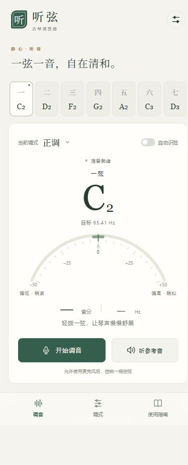

# 听弦 · 古琴调音器

面向手机的七弦古琴调音器，支持 **正调、慢三、紧五、慢二**。提供 Android 离线应用与浏览器版本，共用中文界面和音高检测核心；声音只在设备上处理，不保存或上传录音。

*Tingxian is a seven-string guqin tuner for Android and mobile browsers, with local audio processing and common guqin tunings.*



## 功能

- 一至七弦手动选择，也可自动识弦；慢二的一、二弦同音，使用手动模式。
- 实时显示目标频率、实际频率、音分偏差与偏高／偏低方向。
- 偏差进入 ±5 音分并持续稳定约 650 毫秒后，提示“音准已合”。
- A4 标准音支持 415–466 Hz 整数调整，默认 440 Hz，采用十二平均律。
- 可播放参考音；播放与余音期间暂停音高判定，避免把扬声器声音当作琴声。
- 在本机保存调式、选弦及标准音偏好；离开调音页或切到后台会停止麦克风。
- Android 内置全部页面资源；浏览器版本支持应用资源缓存与添加到主屏幕。

## 定弦表

表中使用科学音高记号，中央 C 为 C4。顺序从最低的一弦到最高的七弦。

| 调式 | 一弦 | 二弦 | 三弦 | 四弦 | 五弦 | 六弦 | 七弦 | 相对正调的变化 |
| --- | --- | --- | --- | --- | --- | --- | --- | --- |
| 正调 | C2 | D2 | F2 | G2 | A2 | C3 | D3 | 常用基准 |
| 慢三（慢角调） | C2 | D2 | E2 | G2 | A2 | C3 | D3 | 三弦降低半音 |
| 紧五（蕤宾调） | C2 | D2 | F2 | G2 | B♭2 | C3 | D3 | 五弦升高半音 |
| 慢二（慢商调） | C2 | C2 | F2 | G2 | A2 | C3 | D3 | 二弦降低全音，与一弦同音 |

A4 = 440 Hz 时，正调目标频率依次为 **65.41、73.42、87.31、98.00、110.00、130.81、146.83 Hz**。慢三的三弦为 **82.41 Hz**，紧五的五弦为 **116.54 Hz**。

这是一组现代常用音高的电子调音参考。古琴的历史绝对音高、传统泛音相和定弦及不同师承的处理可能不同；合奏时应统一标准音。

## 安装与使用

### Android

从 [GitHub Release 下载安卓安装包](https://github.com/yonakiluo-hub/tingxian-guqin-tuner/releases/tag/v1.0.0)，或按下方构建步骤自行生成。APK 作为 Release 附件发布，未提交到 Git 源码历史；当前为体验版，暂未上架应用商店。

要求 **Android 8.0 及以上**，并使用近期版本的 **Android System WebView / Chrome**。安装后选择调式和琴弦，点击“开始调音”，允许麦克风权限，再逐根拨响散音。应用内置资源可离线使用，APK 不声明联网权限。

### 手机浏览器

将 [guqin-tuner/dist](guqin-tuner/dist/) 的全部内容部署到支持 **HTTPS** 的静态网站，即可使用较新版本的 Safari、Chrome 等浏览器打开。iPhone 可从 Safari 分享菜单选择“添加到主屏幕”；Android 可从浏览器菜单安装或添加到主屏幕。

首次需要完整加载资源并允许麦克风。浏览器缓存成功后可离线使用；清理站点数据或缓存后，需要重新联网加载。

### 调音建议

1. 选择曲目需要的调式，初次使用建议手动选弦。
2. 将手机放在琴旁，逐根拨响空弦，轻触其他弦止音。
3. 等拨弦起音过去后观察稳定读数：负数偏低、适当紧弦；正数偏高、适当松弦。
4. 大幅偏离时先核对弦号与八度。每次小幅调整，调好后复查七弦。

## 网页本地运行

需要 **Node.js 22+**。没有 npm 依赖需要安装，也无需前端打包步骤。从仓库根目录运行：

```sh
cd guqin-tuner
npm start
```

在这台电脑上打开 [http://localhost:4173](http://localhost:4173)。开发服务器仅监听本机地址；手机不能通过电脑的局域网地址直接访问它。浏览器麦克风通常要求 HTTPS 或本机 localhost，普通局域网 HTTP 地址不能用于手机录音。

网页结构与开发说明见 [guqin-tuner/README.md](guqin-tuner/README.md)。

## Android 构建

需要 **Python 3.10+、JDK 17、Android SDK Platform 35、Build-Tools 35.0.0**，无需 Gradle。以下命令在 **Windows x64** 的仓库根目录运行：

```powershell
# 下载官方便携工具链到项目内的 work/downloads/ 和 work/toolchain/
python android/setup_toolchain.py

# 将网页资源与 Android 包装编译、打包并签名
python android/build.py --web-dir guqin-tuner/dist --out-dir outputs
```

已有工具链时，可以跳过下载，并用 `JAVA_HOME` 和 `ANDROID_SDK_ROOT` 指定环境；SDK 需包含 `platforms/android-35` 与 `build-tools/35.0.0`。便携工具链下载脚本面向 Windows x64，其他系统的构建流程尚未验证。

构建产物：

- `outputs/Tingxian-Guqin-Tuner-Android.apk`：可安装的体验版 APK。
- `outputs/Android-Build-Verification.txt`：签名、manifest 与 SHA-256 检查结果。

首次构建会在 `android/signing/` 生成本地体验签名。保留同一签名才能直接覆盖安装后续版本；不要将签名文件提交到公开仓库。正式分发前应配置并妥善保管发布签名，当前脚本生成的体验签名不适合正式应用商店发布。

更多权限与生命周期说明见 [android/README.md](android/README.md)。

## 测试与验证范围

从仓库根目录运行：

```sh
cd guqin-tuner
npm test
```

现有 **18 组自动测试**覆盖：

- 四种弦式与七根弦的目标音高、标准音校准。
- 44.1 / 48 kHz 输入、8192 / 16384 点窗口、音分偏差、强泛音、噪声及衰减。
- 安静与无效输入拒绝、范围外纯音拒绝、八度不静默折叠。
- 麦克风权限取消与拒绝、资源释放、后台暂停、参考音避让、稳定音准判定及自动识弦。

252 个主要合成音频案例的已记录最大误差约 **0.178 音分**。该结果属于合成数据测试，**不代表手机麦克风实录精度**。应用行为测试使用模拟 DOM 与音频环境；Android 构建检查覆盖编译、打包、签名及 manifest，均不能代替真机测试。

## 目录

```text
.
├── README.md
├── guqin-tuner/
│   ├── dist/                 # 可直接部署的页面、脚本、样式与图标
│   │   ├── app.js            # 交互、音频生命周期与读数稳定处理
│   │   ├── pitch.js          # 单音音高检测与音分计算
│   │   ├── tunings.js        # 调式与目标频率
│   │   └── sw.js             # 浏览器应用资源缓存
│   ├── tests/                # 音高与应用行为测试
│   ├── server.mjs            # 本机开发服务器
│   └── package.json
├── android/
│   ├── app/src/main/         # Android WebView 包装、权限与资源
│   ├── build.py              # 编译、打包、签名与检查
│   └── setup_toolchain.py    # Windows 便携工具链准备
└── docs/images/              # 项目截图
```

## 当前限制

- 尚未完成真实古琴、Android 或 iPhone 真机麦克风准确度验证。
- 单音算法不支持同时拨响多根弦。弱基音、纯泛音、室内低频噪声、余音及手机降噪可能引起跳动或误判。
- 只有纯二次泛音时，无法仅凭音频确定它来自低八度的哪根弦；同音弦也无法自动区分。建议手动选弦并听辨复核。
- 当前采用十二平均律，尚未提供五度相生律或纯律选项。
- 参考音为合成音，不是古琴采样音色；蓝牙音频链路可能增加延迟或改变低频响应。
- 当前未指定开源许可证。

## 资料出处

- [故宫博物院：《古琴的定弦方式》](https://www.dpm.org.cn/Uploads/File/2022/10/25/u6357951133e58.pdf)：正调及慢三、紧五、慢二的变弦关系。
- [Atlas Ensemble：Guqin by Ziwen Kong](https://www.atlasensemble.nl/assets/files/instruments/Guqin/Guqin%20by%20Ziwen%20Kong.pdf)：古琴常用散音与科学音高记号。
- [de Cheveigné & Kawahara（2002）：YIN, a fundamental frequency estimator for speech and music](https://pubmed.ncbi.nlm.nih.gov/12002874/)：音高检测方法参考。项目独立实现采用归一化差函数的思路，并针对低频拨弦进行候选筛选。
